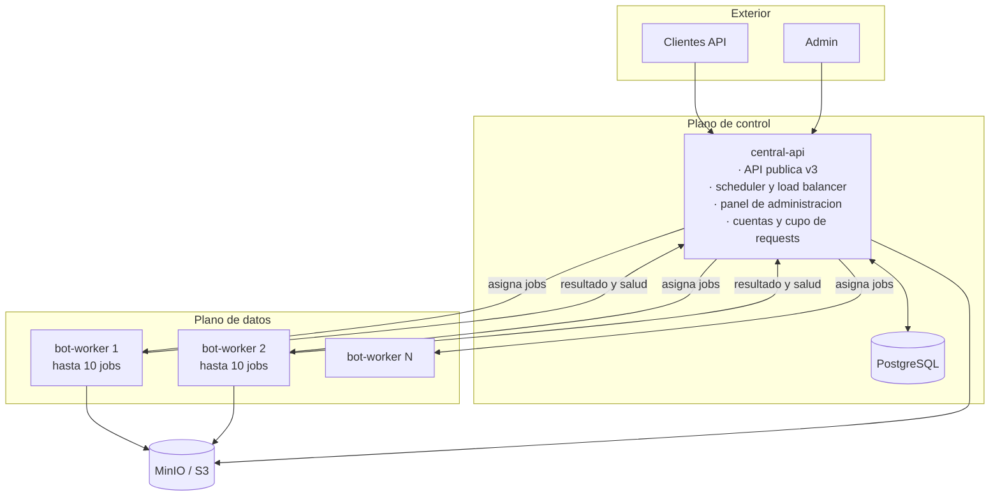
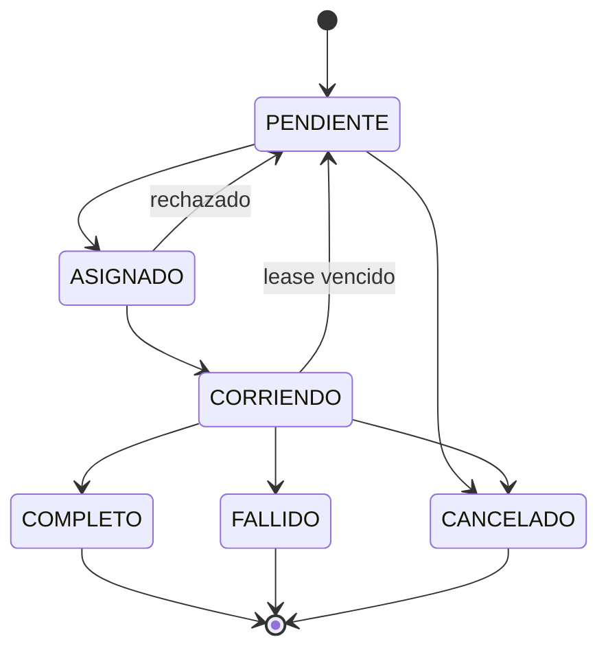

# MrBot API V3

API de automatización de trámites fiscales y previsionales argentinos (ARCA/AFIP,
ARBA, AGIP, SIFERE, SRT y otros organismos), construida como un conjunto de
microservicios.

## Documentación de uso y funcionamiento

La documentación revisada del comportamiento de los bots registrados (35 plugins, 46 operaciones) está en
[`docs/`](docs/README.md):

- [`docs/externa/`](docs/externa/README.md): manual para usuarios e integradores,
  entradas, resultados, archivos y efecto de omitir o dejar vacío cada campo.
- [`docs/interna/`](docs/interna/README.md): API, workers, análisis por bot,
  auditoría y propuestas de mejora de schemas y models.

Para compartir con usuarios, distribuir **únicamente `docs/externa/`**.
Los planes históricos que siguen describen diseño y evolución, no sustituyen
el contrato observado y sus limitaciones documentadas.

> **Estado: implementación verificable.** Las fundaciones, los contratos, el
> plano central, el worker y la infraestructura de desarrollo ya tienen una
> implementación verificable. El diseño histórico se describe en los planes
> (ver [`docs/`](docs/README.md)). La V3 sucede a la V2 (monolito con el
> worker embebido en el proceso de la API).
>
> Las verificaciones de infraestructura y la suite de pruebas se ejecutan con:
>
> ```bash
> ./infra/verify-all.sh
> make test
> ```
>
> Un CI en GitHub Actions corre las pruebas y el análisis Trivy.
>
> Ese ejercicio encontró y corrigió siete defectos reales, entre ellos una fuga
> de capacidad en la consulta de la cola y un `docker-compose` que Docker
> rechazaba por completo. Detalle en [`infra/README.md`](infra/README.md).

---

## Qué es

El sistema recibe pedidos de ejecución de "bots" (automatizaciones de navegador
que inician sesión en sitios de organismos públicos, navegan, y extraen o cargan
información), los encola, los reparte entre una flota de trabajadores, y devuelve
el resultado junto con los archivos generados.

Todas las ejecuciones son **asíncronas**: el cliente envía un pedido, recibe un
`job_id`, y consulta el estado hasta que termina.

## Arquitectura



**Dos reglas definen el diseño:**

1. **Solo la API central conoce la base de datos.** Los workers no tienen
   credenciales de PostgreSQL ni driver instalado.
2. **La API central asigna el trabajo.** Los workers no buscan trabajo: lo
   reciben. Eso es lo que permite balancear carga entre workers sanos y avisar al
   administrador cuando uno deja de responder.

## Componentes

| Componente | Directorio | Descripción |
|---|---|---|
| **central-api** | [`services/central-api/`](services/central-api/) | API pública v3, autenticación, cuotas, planificación y reparto de jobs, registro de la flota, panel de administración, cuentas de cupo (`PRUEBA`, `TESTING`, `NORMAL`) |
| **bot-worker** | [`services/bot-worker/`](services/bot-worker/) | Ejecutor puro. API secundaria privada que solo responde a la central. Corre los bots Playwright. Sin base de datos |
| **mrbot-contracts** | [`packages/mrbot-contracts/`](packages/mrbot-contracts/) | Esquemas compartidos del protocolo entre la central y los workers |
| **infra** | [`infra/`](infra/) | Imágenes, Docker Compose, PostgreSQL, despliegue |

## Estructura del repositorio

Estructura real del repositorio (los planes de diseño `plan.md`, `plans/` y
`workers-swarm.md` fueron retirados del árbol; el diseño vigente se describe
en [`docs/`](docs/README.md)):

```
api-bots-mrbot-v3/
├── README.md                    # este archivo
├── .research/                   # investigación sobre la V2 (insumo del diseño)
├── docs/                        # documentación externa e interna vigente
├── packages/mrbot-contracts/    # contratos compartidos
├── services/central-api/        # servicio central
├── services/bot-worker/         # servicio worker
└── infra/                       # infraestructura
```

Regla de dependencias: `services/*` depende de `packages/*`. `packages/*` no
depende de nada. `central-api` y `bot-worker` **no se importan entre sí**: se
comunican solo por HTTP con los esquemas de `mrbot-contracts`.

## Diferencias principales con la V2

| | V2 | V3 |
|---|---|---|
| Base de datos | SQLite, un archivo | PostgreSQL |
| Worker | embebido en la API | servicio separado, sin base de datos |
| Reparto de trabajo | el worker se auto-asigna desde la base | la central asigna al worker sano |
| Concurrencia | `MAX_BOTS` × `BROWSER_CONCURRENCY` por proceso, sin coordinar | hasta 10 jobs por worker (5 por defecto), tope conocido por el planificador |
| Ejecución síncrona | sí, en `/api/v1` | deprecada |
| ID de usuario | entero autoincremental | UUIDv4 |
| ID de jobs y bots | mixto | UUIDv7 en todo |
| Tablas de resultados | 28 tablas `consulta_*_logs` | `jobs` + `job_results` con `JSONB` |
| Monetización | contador de consultas mensuales | tipo de cuenta (`PRUEBA`/`TESTING`/`NORMAL`) con cupo de requests, asignado a mano desde el panel admin |

Comparar con la V2 excede el alcance de este documento.

## Estado de las ejecuciones



`status` indica el avance. `result` es un eje separado: `OK`, `PARCIAL` o
`ERROR`. Un job puede estar `COMPLETO` con resultado `PARCIAL`.

## Cómo levantar el entorno

Para desarrollo local:

```bash
cp infra/compose/.env.example infra/compose/.env
docker compose -f infra/compose/docker-compose.yml up --build
```

La implementación actual requiere construir las imágenes desde la raíz del
monorepo y aplicar las migraciones como job one-off antes de usar PostgreSQL.

## Uso de la API

> Los endpoints de bots están implementados como jobs asíncronos y sus schemas
> completos se pueden explorar en `GET /api/v3/bots` y `GET /api/v3/bots/{bot}`.

Consultar el catálogo y el schema de un bot:

```http
GET /api/v3/bots/ccma
X-API-Key: <clave>
```

La respuesta incluye `operaciones[].input_schema`,
`operaciones[].credentials_schema` y `operaciones[].example`. Los ejemplos usan
valores ficticios y nunca contienen credenciales reales.

Crear una ejecución con el envelope V3:

```http
POST /api/v3/bots/ccma/consultar
X-API-Key: <clave>
Idempotency-Key: <uuid opcional>
Content-Type: application/json

{
  "payload": {
    "representado_cuit": "20123456789",
    "periodo_desde": "01/2026",
    "incluir_movimientos": true,
    "incluir_pdf": true,
    "subir": true
  },
  "credentials": {
    "cuit_representante": "20123456789",
    "clave": "clave_fiscal"
  }
}
```

```json
{ "success": true, "job_id": "018f...", "status": "PENDIENTE" }
```

Los aliases históricos conservan el body plano de V1/V2. Por ejemplo, CCMA:

```http
POST /api/v3/ccma/consulta
X-API-Key: <clave>
Content-Type: application/json

{
  "cuit_representante": "20123456789",
  "clave_representante": "clave_fiscal",
  "cuit_representado": "20123456789",
  "movimientos": true,
  "pdf": true
}
```

Consultar el resultado del job:

```http
GET /api/v3/jobs/018f...
X-API-Key: <clave>
```

```json
{
  "job_id": "018f...",
  "status": "COMPLETO",
  "result": "OK",
  "bot": "mis_comprobantes",
  "operation": "consulta",
  "files": [{
    "filename": "comprobantes-2025.zip",
    "download_url": "/api/v3/jobs/018f.../artifacts/.../download",
    "size_bytes": 20480
  }],
  "data": { "schema_version": 1, "items": [] }
}
```

## Hoja de ruta

| Fase | Objetivo |
|---|---|
| F0 | Fundaciones del monorepo, contratos, Compose y CI |
| F1 | Esquema PostgreSQL y migraciones |
| F2 | Plano de control mínimo y un bot de punta a punta |
| F3 | Portado de los bots (35 plugins, 46 operaciones) |
| F4 | Cuentas PRUEBA/TESTING/NORMAL con cupo de requests (sin pagos automáticos) |
| F5 | Panel de administración y observabilidad de la flota |
| F6 | Endurecimiento, pruebas de carga y caos, cutover |

## Documentación

| Documento | Contenido |
|---|---|
| [`docs/`](docs/README.md) | Índice: documentación externa (usuarios) e interna (desarrollo) |
| [`docs/externa/`](docs/externa/README.md) | Manual para usuarios e integradores |
| [`docs/interna/`](docs/interna/README.md) | API, workers, análisis por bot, auditoría y validación |
| [`infra/README.md`](infra/README.md) | Imágenes, Compose, verificaciones y despliegue |
| [`.research/`](.research/) | Investigación sobre la V2 que fundamenta el diseño |

## Licencia

Privado. Todos los derechos reservados.
