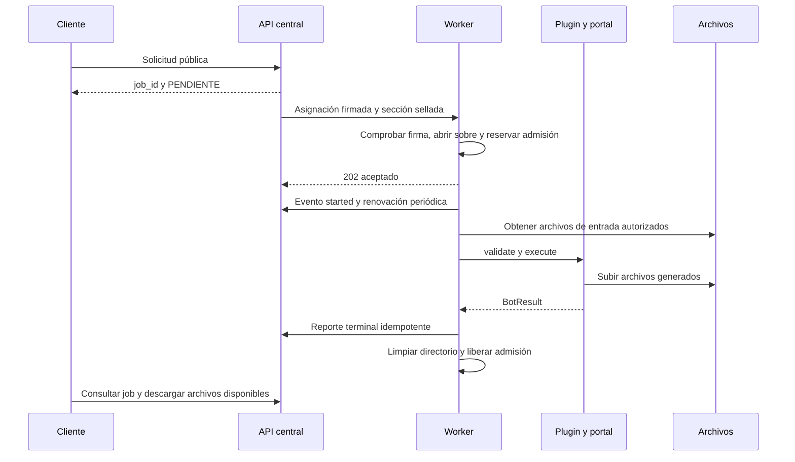

# Workers: funcionamiento efectivo

Revisión: 20 de octubre de 2026. Este documento es interno. Describe la implementación del repositorio, no el estado de un despliegue ni una certificación de los portales externos.

## Responsabilidades y fuentes

La central valida la solicitud pública, conserva el estado canónico, reserva consumo, elige un worker y le entrega una asignación. El worker no consulta la base de datos: recibe un sobre autocontenido, ejecuta un plugin, entrega archivos y reporta el resultado. El registro carga 34 plugins y una variante de AGIP. Los prototipos de `bots_dev/` no son automáticamente bots publicados.

Fuentes principales:

- `services/bot-worker/src/bot_worker/main.py:276-354`, `:729-813`, `:1200-1535`: apertura, admisión y ejecución.
- `services/bot-worker/src/bot_worker/bots/registry.py:34-95`, `:108-201`: manifiesto, protocolo y registro diferido.
- `services/bot-worker/src/bot_worker/bots/_plugins.py`: inventario y variante, no lista paralela de capacidades.
- `services/central-api/src/central_api/scheduler/dispatcher.py:123-135`, `:190-312`: traducción de operación y construcción del sobre.

## Recorrido de una ejecución

La aceptación no ejecuta todavía la validación de negocio completa. `envelope_errors` comprueba protocolo, UUID, lease, plugin, operación, presencia de credenciales requeridas y límites de slots. `plugin.validate()` se ejecuta dentro del runner, después de descargar las entradas. Una solicitud que pasó la central puede fallar luego si los modelos difieren.

## Contrato interno de asignación

| Campo o grupo | Función y comportamiento |
|---|---|
| `protocol_version` | Debe coincidir con el protocolo admitido. |
| `job_id`, `attempt`, `lease_id`, `lease_expires_at` | Identifican trabajo e intento. UUID válidos, intento al menos 1 y lease futura. |
| `bot`, `plugin`, `plugin_version`, `operation` | Selección de ejecutor. La operación debe pertenecer al manifiesto. `plugin` prevalece sobre `bot` al resolver. La versión declarada no sustituye la comprobación de compatibilidad del despliegue. |
| `assignment_signature`, `assignment_expires_at`, `assignment_token` | Autorización y correlación de la asignación. No deben exponerse al consumidor. |
| `sealed`, `sealed_section` | Acepta sección cifrada como objeto en `sealed` o como `sealed_section`. Al abrirla, reemplaza credenciales y provisión en memoria y borra los dos campos del objeto abierto. |
| `payload` | Datos del bot. `validation_payload()` impone `operacion` desde el sobre, sobre cualquier valor del cliente. |
| `credentials` | Se convierte a `FiscalCredentials(cuit_representante, clave)`. Presencia del objeto no equivale a validar credenciales ante el organismo. |
| `proxy_profile`, `captcha_profile`, `service_profile` | Provisión operativa de la central. El plugin se copia antes de `configure()` para no compartir configuración mutable entre jobs. |
| `input_files` | Referencias autorizadas a entradas. Se sustituyen por nombres locales antes de validar el plugin. |
| `artifact_uploads` | Hasta 16 slots explícitos, con suma declarada de hasta 250 MiB. No confundir ese chequeo del sobre con un contador global de todos los archivos dinámicos generados. |
| `deadline_at` | Presupuesto de tiempo. Si no puede interpretarse se usa el timeout configurado del worker. |
| `force` | Opción administrativa firmada con alcance especial. Omite límite de admisión, no el semáforo de ejecución. No es un campo público para saltarse cuotas. |

Los modelos locales del sobre están en `main.py:123-240`. Hay también contratos compartidos en `packages/mrbot-contracts/src/mrbot_contracts/`. No son intercambiables por su nombre: hay que comprobar las proyecciones efectivamente consumidas.

## Capacidad, cola y plazos

- Por defecto: 5 ejecuciones concurrentes y 0 de cola local. Configuración CLI: concurrencia de 1 a 10 y cola de 0 a 10 (`config.py:95-135`).
- `accept()` deduplica por `(job_id, attempt, lease_id)` bajo lock. Mismo job e intento con otra lease activa produce conflicto.
- Admisión regular: como máximo `capacity + queue_limit` trabajos retenidos. Ejecución efectiva: semáforo de `capacity`.
- `force` puede aumentar los trabajos admitidos, pero estos esperan el mismo semáforo. Por tanto `en_ejecucion` incluye admitidos todavía no ejecutándose y no es equivalente al número de navegadores abiertos.
- El timeout del `execute()` es el mínimo de deadline restante, timeout del manifiesto y timeout global. El runner fuerza un mínimo de un segundo a `wait_for`.
- **Límite real:** descarga de entradas y validación ocurren antes del `wait_for`; no están incluidas en ese límite global de ejecución. El timeout se calcula antes de esas etapas y no se recalcula después.
- La renovación de lease envía `heartbeat_hint` cada 20 segundos. El heartbeat de salud del proceso y la renovación del intento son circuitos distintos.

Fuentes: `scheduler/supervisor.py:54-122`, `:183-200`; `main.py:1205-1220`, `:1347-1385`, `:1595-1642`.

## Entradas y archivos

`runtime/input_files.py` descarga archivos de hasta 50 MiB y rechaza contenido vacío. Para listas `archivos`, expande ZIP con hasta 500 miembros regulares y hasta 200 MiB descomprimidos declarados. Rechaza enlaces simbólicos. Los nombres se reducen al último segmento del miembro, por lo que dos carpetas distintas con un mismo nombre de archivo pueden colisionar.

Los campos individuales se reescriben a nombres locales. Los nombres repetidos entre campos se prefijan con el nombre del campo. No se debe documentar una ruta del servidor como input público. El contrato público de upload y las restricciones por campo se detallan en [API](api.md).

`ArtifactStore` solo permite resolver rutas dentro del directorio de trabajo, calcula tamaño y SHA-256 y exige slots o nombres autorizados por el manifiesto. Solicita URLs de subida bajo demanda. Si se vuelve a usar el mismo identificador, solicita un destino nuevo para evitar pisar el archivo anterior. El límite de cada slot no representa por sí solo un límite total del job.

Fuentes: `runtime/input_files.py:17-128`; `runtime/context.py:156-266`.

## Resultado del plugin frente al resultado público

`BotResult` admite `result`, `data`, `artifacts`, `errors`, `warnings` y `metrics`. `OK` y `PARCIAL` se consideran completados. El runner clasifica timeout, cancelación, credenciales rechazadas, fallo del navegador, captcha, uploads y errores de negocio.

**Diferencia importante:** el runner construye un objeto temporal con `warnings` y `metrics`, pero el callback terminal solo incluye `result`, `data`, `artifacts`, `error`, intento, evento y categoría. `errors` tampoco se proyecta. El modelo receptor `ResultBody` no declara advertencias ni métricas. Solamente las advertencias que el plugin copie dentro de `data` pueden llegar de esa forma. Las fichas externas no deben prometer un campo superior `warnings` por el solo hecho de existir en `BotResult`.

Fuentes: `runtime/context.py:76-90`; `main.py:1386-1398`, `:1464-1489`; `services/central-api/src/central_api/internal/job_results.py:59-95`.

## Cancelación, fallos y recuperación

La cancelación es cooperativa. Señala un token y el job se detiene cuando el flujo lo consulta o cuando se cancela la tarea. **No revierte presentaciones, importaciones, compensaciones ni generación de VEP ya realizadas.** Después de ejecutar, una cancelación pendiente puede reemplazar la salida por resultado de cancelación vacío.

Al cerrar el proceso se activa drenaje, se rechaza trabajo nuevo y se espera hasta 120 segundos por defecto. Al vencer, se solicita cancelación y se espera otros 10 segundos. La limpieza se hace en `finally` con borrado best-effort del directorio y liberación del permiso. Una caída abrupta no ejecuta `finally`, por lo que la eliminación efectiva depende también del almacenamiento efímero del despliegue.

**No confundir los dos reapers:** con persistencia, un `CORRIENDO` vencido sin resultado durable falla sin repetirse, para evitar efectos duplicados. Un `ASIGNADO` puede volver a cola según intentos y evidencia durable. El reaper de la ruta en memoria tiene otra semántica y puede reencolar un `CORRIENDO`. El estado persistido es la referencia para producción.

Fuentes: `scheduler/supervisor.py:148-165`; `main.py:1459-1462`, `:1490-1535`, `:1538-1592`; `runtime/workdir.py:22-37`; `services/central-api/src/central_api/scheduler/loop.py:32-73`; `services/central-api/src/central_api/repositories/jobs.py:750-884`; `services/central-api/src/central_api/scheduler/reaper.py:79-112`.

## Entrega terminal: garantías y límites observados

El callback se intenta hasta 4 veces con esperas de 1, 2 y 4 segundos. Reintenta transporte o respuestas 5xx, no vuelve a ejecutar el bot en ese bucle. La clave es estable por job e intento. Sin embargo, actualmente `send_result()` trata cualquier código menor a 500 como confirmación, incluidos 401, 403, 409 y 422. No equivale a aceptación durable.

Si se agotan los reintentos, el log dice que conserva la tarea, pero el `finally` elimina el directorio y libera el job. No existe una bandeja durable de resultados pendientes en ese módulo. Esta es una limitación actual, no una garantía de entrega.

Las cachés de admisiones y reportes viven en memoria sin purga observada. Crecen con el número histórico de intentos durante la vida del proceso. Revisar la auditoría antes de dimensionar procesos de larga duración.

Fuentes: `reporting/results.py:16-78`; `main.py:1504-1535`; `scheduler/supervisor.py:68-70`, `:107-120`, `:183-197`.

## Comprobaciones locales

1. Validar cada ejemplo público tanto con la central como con el plugin, sin ejecutar el portal.
2. Probar ausente, `null`, `""`, espacios, `false`, lista vacía y límites para cada campo, sin asumir que son equivalentes.
3. Probar resultado parcial a través de la frontera plugin → callback → consulta pública.
4. Simular callback 401/403/409/422/503 y verificar qué se conserva.
5. Probar cancelación en cola y después de una acción con efectos externos.
6. Probar ZIP con nombres repetidos y descarga lenta antes de `execute()`.
7. Ejecutar suites por paquete para evitar la colisión actual de nombres de módulos de test.

Las fichas individuales están en [el índice interno](README.md).
