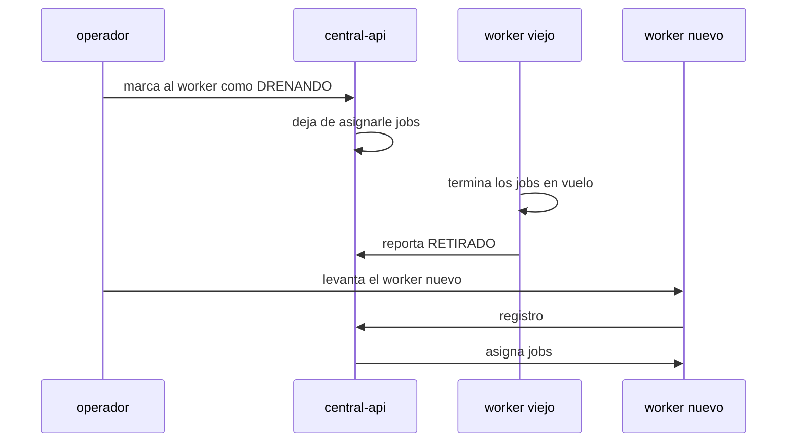

# infra

Infraestructura de la V3: imágenes, orquestación local, base de datos y
despliegue.

> **Estado: despliegue por subdirectorios implementado.** Diseño en
> [`../plans/06-infra/plan.md`](../plans/06-infra/plan.md).

---

## Contenido

```
infra/
├── README.md
├── verify-all.sh                 # punto de entrada de las verificaciones vigentes
├── check-consistency.py          # coherencia de vocabulario y rutas entre planes
├── validate-code-blocks.py       # sintaxis de los bloques de codigo de los planes
├── verify-packaging.sh           # compose y Dockerfiles contra las herramientas de Docker
├── verify-worker-isolation.sh    # el worker real sin driver PG ni secretos central
├── compose/
│   ├── compose.yaml              # entrada estándar desde infra/compose
│   ├── docker-compose.yml        # stack completo de desarrollo
│   ├── docker-compose.prod.yml   # superposicion de produccion
│   ├── central/db/worker/relay *.compose.yaml y *.env.example  # despliegue por rol
│   └── .env.example              # WORKER_NODES, CENTRAL_URL, secretos por destino (archivo oculto)
├── postgres/
│   ├── verify-ddl.sh             # valida el esquema del plan contra PG 17 real
│   ├── _extract_claim.py         # extrae la consulta de cola desde el plan
│   ├── init/
│   │   ├── 01-extensions.sql     # pgcrypto opcional, sin DDL de tablas
│   │   └── README.md
│   └── backup/                   # rutina de respaldo
└── deploy/
    └── runbooks/
        ├── despliegue-worker.md  # worker con solo CENTRAL_URL mas token
        ├── despliegue-central.md # central con solo la lista de IPs
        └── relay-workers.md      # workers detrás de NAT vía frp (relay)
```

## Despliegue por subdirectorios

Cada destino se despliega con lo minimo que necesita:

- Stack local: `docker compose -f compose/docker-compose.yml up -d
  --scale bot-worker=2` (postgres 17 mas central mas workers).
- Produccion: superposicion `docker-compose.prod.yml` con imagenes por
  digest, `WORKER_NODES` obligatorio y MinIO local desactivado.
- Worker dedicado: solo `CENTRAL_URL` mas token, ver
  [`deploy/runbooks/despliegue-worker.md`](deploy/runbooks/despliegue-worker.md).
- Central: solo la lista de IPs de workers, ver
  [`deploy/runbooks/despliegue-central.md`](deploy/runbooks/despliegue-central.md).
- Workers detrás de NAT (frp): ver
  [`deploy/runbooks/relay-workers.md`](deploy/runbooks/relay-workers.md).
- Entrada estándar: `compose.yaml` desde la raíz o desde `infra/compose`.
- nginx-v2: `central-api.mrbot.com.ar`, `worker-${WORKER_NUMBER:-1}.mrbot.com.ar`
  y, mediante el perfil explícito `database-ui`, `database-bots.mrbot.com.ar`.
  El último es Adminer sobre PostgreSQL, no una publicación TCP de la base.
- Imagenes: [`../services/central-api/Dockerfile`](../services/central-api/Dockerfile)
  y [`../services/bot-worker/Dockerfile`](../services/bot-worker/Dockerfile),
  con [guia de central](../services/central-api/DEPLOY.md) y
  [guia de worker](../services/bot-worker/DEPLOY.md).

## Verificaciones

`make verify` ejecuta comprobaciones sobre los archivos presentes en el
repositorio. Requiere Python 3 con `pyyaml` y Docker Compose; no requiere el
daemon de Docker ni secretos.

```bash
make verify
./infra/verify-worker-isolation.sh   # solo el aislamiento del worker
make compose-config                  # solo configuración Compose
```

| Verificación | Qué comprueba |
|---|---|
| `validate-code-blocks.py` | Sintaxis de bloques JSON, Python, YAML, TOML y estructura Mermaid en la documentación |
| `verify-worker-isolation.sh` | Manifiesto, Dockerfile, código y Compose del worker sin drivers de base de datos ni secretos de la central |
| `compose-config` | Validez del archivo `compose/docker-compose.yml` con Docker Compose, sin cargar `.env` ni resolver archivos de entorno de los servicios |

Las herramientas históricas `check-consistency.py`, `verify-packaging.sh` y
`postgres/verify-ddl.sh` dependen de archivos `plans/` que no forman parte de
este checkout. Se conservan para cuando esos planes estén disponibles y no
forman parte de `make verify`.

## Stack

| Servicio | Imagen | Estado | Notas |
|---|---|---|---|
| `postgres` | `postgres:17` | stateful | Volumen persistente. Única base de datos del sistema |
| `central-api` | construida | stateless | Python slim. Sin navegador. Con driver de PostgreSQL |
| `bot-worker` | construida | stateless | Base Playwright. **Sin** driver de PostgreSQL |
| `minio` | externa o local | stateful | Almacenamiento de artefactos. Ya existe en la V2 |

## Las dos imágenes

La separación de dependencias no es cosmética, hace cumplir el invariante W-1.

| Dependencia | central-api | bot-worker |
|---|---|---|
| fastapi, uvicorn | sí | sí |
| sqlalchemy, alembic, psycopg | **sí** | **no** |
| playwright, playwright-stealth | **no** | **sí** |
| pandas, numpy, openpyxl | no | sí |
| pdfplumber, beautifulsoup4 | sí (utilidades) | sí |
| minio | sí (firma URLs) | no (usa URLs prefirmadas) |
| jinja2 | sí (panel) | no |

El build del `Dockerfile` del worker falla si `psycopg`, `sqlalchemy` o `alembic`
son importables, y `verify-worker-isolation.sh` lo comprueba sobre los archivos reales.

## Puntos críticos de Playwright en contenedores

| Ajuste | Valor | Por qué |
|---|---|---|
| `/dev/shm` | `tmpfs` en memoria, 1 GB | Sin esto Chromium se cae bajo concurrencia. Es el error más común |
| `init: true` | activado | Recoge procesos de navegador huérfanos |
| `pids_limit` | 512 | Evita que procesos descontrolados agoten el host |
| `stop_grace_period` | ≥ tiempo de drenaje | Permite terminar los jobs en vuelo antes de matar el contenedor |
| memoria | 4 GB por worker | 5 Chromium concurrentes a 300-500 MB cada uno |

## Secretos por destino

Regla: cada secreto va **solo** al servicio que lo necesita.

| Secreto | central-api | bot-worker |
|---|---|---|
| `DATABASE_URL` | sí | **nunca** |
| Clave privada RSA | sí | **nunca** |
| Credenciales de MinIO | sí | **nunca** |
| `SMTP_*` | sí | **nunca** |
| Credenciales del panel admin | sí | **nunca** |
| Claves de resolución de captcha | no | sí |
| Configuración de proxies | no | sí |
| Token del worker | emite | consume |

## Migraciones

Alembic corre como **trabajo único**, nunca en el `CMD` del contenedor. La V2
tenía `alembic upgrade head` en el `CMD` del `Dockerfile`, lo que se rompe con
más de una réplica.

Toda migración sigue la regla expandir/contraer: agregar columna opcional,
desplegar, rellenar, y contraer en un despliegue posterior. Así un rollback de
imagen no rompe contra el esquema nuevo.

## Respaldo

| Qué | Cómo | Frecuencia | Retención |
|---|---|---|---|
| PostgreSQL | `pg_dump` al almacenamiento de objetos (`postgres/backup/`) | diaria 02:00 UTC y previa a migracion | 30 diarios, 12 mensuales, 4 anuales |
| Artefactos | política del bucket | continua | por definir |
| Claves RSA | fuera de banda, cifradas | ante rotación | permanente |

Un respaldo sin prueba de restauración no es un respaldo. El procedimiento de
restauración se prueba y se documenta.

## Despliegue

Destino inicial: Docker Compose en VPS, que es donde está hoy la V2.

Camino posterior: k3s con KEDA para autoescalar réplicas de worker según la
profundidad de la cola. Esto es compatible con la V3 siempre que quede claro el
reparto de roles:

- **KEDA decide cuántos workers existen** (autoescalado de infraestructura).
- **La API central decide qué worker ejecuta cada job** (asignación de trabajo).

Son dos responsabilidades distintas y no entran en conflicto si se mantienen
separadas.

## Actualización sin perder trabajo



## Documentos relacionados

- [`plans/06-infra/plan.md`](../plans/06-infra/plan.md) - diseño de infraestructura
- [`plans/01-database/plan.md`](../plans/01-database/plan.md) - esquema y migraciones
- [`plans/07-migracion/plan.md`](../plans/07-migracion/plan.md) - cutover desde la V2
