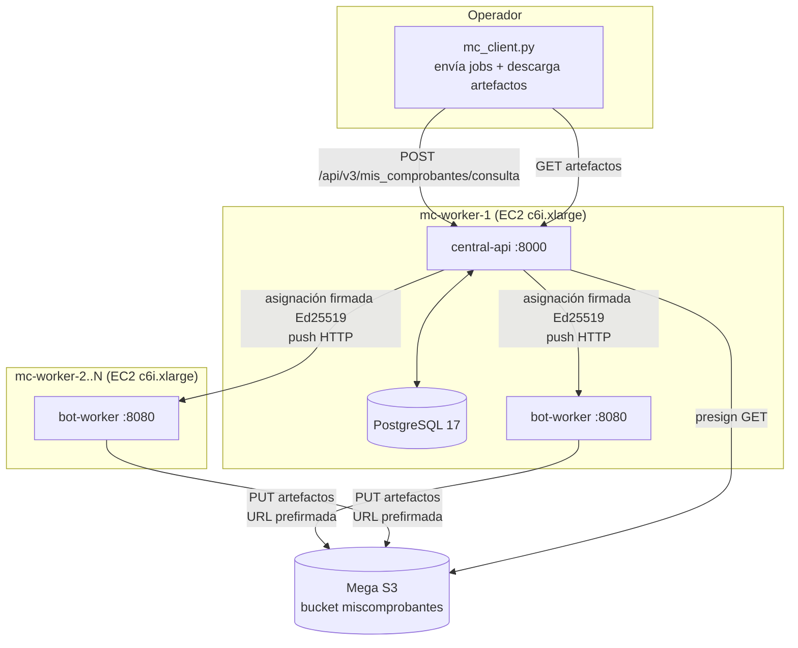

# workers-swarm.md — Reparto de trabajo en flota EC2 efímera

> **Estado:** documento de diseño + resultados de prueba de concepto (2026-10-01).
>
> **Destino:** implementación en la **API V3** (modificación futura).
>
> **Fuentes:** `plan.md`, `plans/06-infra/plan.md`, `plans/03-worker/plan.md`,
> `plans/02-central-api/plan.md`, código real de `services/central-api` y
> `services/bot-worker`.
>
> **Invariantes que toca:** W-1, W-2, W-3, I-4, SEC-3 (no se relajan).

---

## 0. Resumen ejecutivo

Se probó de punta a punta, **sin modificar el código de la V3**, un reparto de trabajo
sobre una **flota efímera de 4 instancias EC2** (`c6i.xlarge`, 4 vCPU / 8 GiB) en
`sa-east-1`, con la central (control + PostgreSQL) corriendo en la primera instancia y
las otras 3 como workers puros.

Resultado de la corrida real:

| Métrica | Valor |
|---|---|
| Contribuyentes | 83 |
| Instancias worker | 4 × `c6i.xlarge` (4 vCPU / 8 GiB) |
| Jobs concurrentes por worker | 5 (`WORKER_CONCURRENCY`) |
| Tiempo de envío de las 83 solicitudes | 74.0 s |
| **Tiempo de procesamiento** (desde el último envío) | **116.7 s ≈ 1.95 min** |
| Tiempo total (envío + procesamiento) | 190.7 s ≈ 3.18 min |
| Completados / Fallidos | 77 / 6 |
| Archivos descargados (Mega S3 → `./descargas`) | 150 (4.3 MB) |

Este documento describe:
1. la arquitectura observada y cómo encaja con los invariantes de la V3;
2. los **defectos reales** encontrados (para corregir en la V3);
3. el procedimiento reproducible;
4. la propuesta de **modificación a la API V3** para soportar la flota por sí misma.

---

## 1. Arquitectura observada



**Modelo de reparto: PUSH.** La central **no** encola en un broker: mantiene el
`job` en PostgreSQL y **empuja** la asignación firmada al worker por HTTP
(`POST /internal/v1/jobs/...`). El worker nunca consulta trabajo. Por eso la
central debe poder alcanzar a cada worker (`advertised_url`), y el worker debe
poder llamar de vuelta a la central (heartbeat, eventos, resultado).

Topología de red usada (todas en el **default VPC**, misma subred privada `172.31.0.0/16`):

| Nodo | Rol | `central-url` | `advertised-url` |
|---|---|---|---|
| mc-worker-1 | central-api + postgres + bot-worker | `http://<priv-1>:8000` | `http://<priv-1>:8080` |
| mc-worker-2 | bot-worker | `http://<priv-1>:8000` | `http://<priv-2>:8080` |
| mc-worker-N | bot-worker | `http://<priv-1>:8000` | `http://<priv-N>:8080` |

`WORKER_NODES` de la central lista **todas** las IPs privadas `ip:8080` (inventario).

---

## 2. Encaje con los invariantes de la V3

| Invariante | Cómo se cumple |
|---|---|
| **W-1** (worker sin DB) | El `bot-worker` no recibe `DATABASE_URL`; PostgreSQL solo se expone en la instancia de la central. |
| **W-2** (máx. 5 jobs) | `--concurrency 5` por CLI (tope fijo 1..5). |
| **W-3** (worker no publica puertos públicos) | El worker se expone `8080` solo dentro del SG privado (`172.31.0.0/16`), nunca a Internet. |
| **I-4** (solo la central toca PostgreSQL) | Confirmado: el SG del worker no abre 5432; Postgres escucha en la red `control`. |
| **SEC-3** (worker sin secretos de central) | El worker recibe credenciales fiscales, proxy, captcha y URLs prefirmadas por **asignación sellada**, en memoria. Nunca en su entorno. |

> **Corrección de despliegue:** el host que corre la central **debe usar un security
> group que permita el puerto 8000** desde el CIDR privado del VPC. En la prueba, la
> instancia de la central era también worker y su SG no abría 8000, lo que dejó a los
> demás workers en `ConnectTimeout` hasta agregar la regla.

---

## 3. Defectos reales encontrados (a corregir en V3)

Estos son hallazgos **observados**, no teóricos. Se listan con la corrección propuesta.

### D-1 — El worker se registra con identidad temporal `sin-asignar`

**Síntoma:** `POST /internal/v1/workers/sin-asignar/heartbeat` → `404`.
**Causa:** tras un registro fallido, el worker conserva el `worker_id` por defecto
(`"sin-asignar"`) y late con esa ruta.
**Corrección V3:** que el heartbeat use el `node` (o el `worker_id` devuelto por el
registro) y **reintente el registro** antes de latir; hoy `advertised_url` es estable,
así que el nodo es la clave correcta.

### D-2 — Firma de asignaciones: `ASSIGNMENT_SIGNING_KEY` no puede ir en `environment` de Compose

**Síntoma:** `500` en `POST /workers/register` con
`AssignmentSignError: ASSIGNMENT_SIGNING_KEY inválida`.
**Causa:** una clave PEM Ed25519 tiene saltos de línea; `docker compose` no soporta
valores multilínea en `environment:`/`.env` (se corrompen con `\n` literales).
**Corrección V3:** usar **siempre** el soporte `*_FILE` (`ASSIGNMENT_SIGNING_KEY_FILE`)
con el PEM montado como archivo (Docker secret). Ya existe en `settings.py`
(`_secret_file_content`); hay que **documentarlo como obligatorio** y no aceptar el
valor inline para PEM.

### D-3 — El archivo de la clave debe ser legible por el usuario del contenedor

**Síntoma:** el PEM montado `chmod 600` de `ec2-user` da `Permission denied` dentro
del contenedor (corre como usuario no root).
**Corrección V3:** montar el secreto con `mode: 0444` (o propiedad correcta) y validar
al arranque que la clave es legible; si no, fallar con mensaje claro.

### D-4 — **Bug de facturación**: los créditos del admin no habilitan jobs

Este es el defecto más importante.

**Síntoma:** con plan `free` el usuario quedó bloqueado a **20 jobs** (`429 quota_exhausted`)
aunque se le cargaran 5000–10000 créditos por admin.
**Causa (código real):**
- `billing/reservation.py::reserve_for_job` abre el período con
  `open_period(user_id, plan_code)` donde `plan_code` **por defecto es `"free"`** (20/mes).
- Cuando la cuota se agota, cae a créditos consultando `BALANCES` (diccionario en memoria
  de `reservation.py`).
- El endpoint admin `POST /admin/users/{id}/credits` llama a
  `admin/users.py::aplicar_credito`, que actualiza **otro** store:
  `USERS[id].saldo_creditos` y `CREDIT_LEDGER`.
- **`BALANCES` y `USERS[].saldo_creditos` son diccionarios distintos** → los créditos
  cargados por admin **nunca** llegan a la reserva → sigue lanzando `QuotaExhausted`.

**Corrección V3 (prioridad alta):**
1. `reserve_for_job` debe tomar el plan **efectivo del usuario** (`USERS[id].plan` /
   `subscriptions`), no el default `"free"`.
2. Unificar la fuente de saldo: `aplicar_credito` debe llamar a
   `_append_credit(...)` (o `BALANCES[user_id] += delta`) para que la reserva vea el
   saldo. En PostgreSQL, la reserva y el cobro deben hacer `SELECT ... FOR UPDATE` sobre
   el mismo libro (`credit_ledger`).
3. Exponer en el panel/servicio un **modo de cortesía** (`plan` con cuota `ilimitada`
   o un `bypass_quota` auditable) para pruebas operativas.

**Workaround usado en la PoC (sin tocar código):**
`POST /admin/billing/accounts/{user_id}/period/force` con `{"plan":"empresa"}` abre un
período nuevo con **cuota 20000**, que sí alcanza para 83 jobs.

### D-5 — La cuota es por período, no por "jobs pendientes"

**Observación:** al subir el plan del usuario sin forzar período, los jobs siguen
bloqueados a 20 (el período `free` ya abierto no se recrea).
**Corrección V3:** el cambio de plan debería cerrar el período abierto y abrir uno nuevo
con la cuota del plan nuevo, o permitir "recargar" la cuota del período vigente de forma
explícita y trazable.

### D-6 — Límite de vCPU de la cuenta (restricción de AWS, no de la V3)

La cuenta tenía **16 vCPU totales** (todas las familias comparten el mismo bucket).
8 × 4 vCPU + central = 36 vCPU es imposible. El dimensionamiento de la flota depende de
la cuota de la cuenta; la V3 debe **leer el límite** (Service Quotas) o al menos
**exponer** una recomendación de tamaño, y no asumir 8 workers fijos.

---

## 4. Procedimiento reproducible (PoC)

> Todos los scripts viven en `/home/abp/Desktop/test-aws/deploy/` y usan `paramiko` +
> `boto3` con el usuario IAM `ec2-test-user` (solo `AmazonEC2FullAccess`).

### 4.0 Requisitos previos

- Imagen del worker y de la central publicadas en el registry:
  ```bash
  docker build -f services/bot-worker/Dockerfile   -t <registry>/mrbot-bot-worker:<tag>  .
  docker build -f services/central-api/Dockerfile  -t <registry>/mrbot-central-api:<tag> .
  docker push <registry>/mrbot-bot-worker:<tag>
  docker push <registry>/mrbot-central-api:<tag>
  ```
- Bucket S3 compatible (Mega) con `OBJECT_STORAGE_*` en el `.env` de la central.
- `ARCA_CAPMONSTER_API_KEY` real (la de desarrollo viene `"sin-configurar"` y **no**
  resuelve captcha).

### 4.1 Red (idempotente)

`step1_network.py`: crea keypair `mc-deploy-key` y security groups.

- `mc-worker-sg`: `22` (IP del operador), `8080` y `8000` desde `172.31.0.0/16`.
- `mc-central-sg`: `22` (operador), `8000` (operador + VPC).

> Regla práctica: **el SG del host de la central debe permitir 8000 desde el VPC**
> (ver §2, corrección de despliegue).

### 4.2 Instancias

`step8_relaunch_4vcpu.py` (versión 4 vCPU): termina todo lo del proyecto y lanza
N × `c6i.xlarge`. User-data instala Docker Engine + plugin `docker compose` v2.40.3.

### 4.3 Despliegue

`step4_deploy.py` (paramiko por SSH):

1. `cloud-init --wait`, `docker login` al registry.
2. En el nodo 1: escribe `central.env`, sube `central.compose.yml` y el PEM de firma,
   levanta `postgres` + `central-api`, corre `migrate`.
3. En cada nodo: escribe `worker.env`, sube `worker.compose.yml`, levanta `bot-worker`.

### 4.4 Aprovisionamiento de usuario y cuota

`step7_new_user.py`:

```bash
# 1) alta pública
POST /api/v3/usuarios   {"usuario":"mc-run@example.com","nombre":"MC Run"}
# 2) habilitar (requiere Bearer ADMIN_TOKEN)
POST /admin/users/{id}/enable   {"motivo":"..."}
# 3) plan
POST /admin/users/{id}/plan     {"plan":"empresa","motivo":"..."}
# 4) créditos (hoy NO habilitan jobs; ver D-4)
POST /admin/users/{id}/credits  {"delta":10000,"motivo":"..."}
# 5) workaround D-4: forzar período con cuota del plan
POST /admin/billing/accounts/{id}/period/force  {"plan":"empresa","motivo":"..."}
```

### 4.5 Corrida

`mc_client.py` (en `/home/abp/Desktop/test-aws/`):

- Lee `Listado Mis Comprobantes 2.0.xlsx` (hoja `Listado`; columnas `Cliente`,
  `CUIT AFIP`, `CUIT en pagina`, `CLAVE`, `Desde`, `Hasta`).
- Envía un job por contribuyente a `POST /api/v3/mis_comprobantes/consulta`
  (compat V2: `cuit_inicio_sesion`, `contrasena`, `representado_cuit`, `representado_nombre`,
  `desde`, `hasta`, `descarga_emitidos`, `descarga_recibidos`, `carga_minio`, `carga_json`),
  con retry ante `429`.
- **Cronómetro**: arranca **después** de enviar la última solicitud (requisito del pedido).
- Descarga los artefactos (`/api/v3/jobs/{id}/artifacts/{aid}/download`) a `./descargas`.

Variables: `CENTRAL_URL`, `MC_EMAIL`, `MC_KEY_FILE`.

### 4.6 Limpieza

Terminar todas las instancias con tag `Project=mc-distributed` y auditar
EBS/EIP/snapshots (ver §6). **Siempre** verificar cero huérfanos.

---

## 5. Propuesta de modificación a la API V3

Objetivo: que la V3 **gestione la flota por sí misma**, sin scripts externos.

### 5.1 Nuevo módulo `infra/provisioner` (fuera del proceso central)

Un servicio/CLI (`central_api.ops.provisioner`) que:

1. Lee un manifiesto de flota (YAML) con: región, tipo de instancia, N, AMI,
   keypair, SG, registry, tags.
2. Consulta la **cuota de vCPU** disponible y **valida** que `N × vCPU + central ≤ cuota`
   (falla temprano con mensaje claro; ver D-6).
3. Lanza instancias, espera `cloud-init`, hace `docker login`, despliega
   `central`/`worker` con `docker compose` (idempotente).
4. Registra las IPs privadas en `WORKER_NODES` **antes** de levantar la central.
5. Comprueba `GET /internal/v1/status` de cada worker y reporta el estado de la flota
   en el panel admin existente (`/admin/workers`).

### 5.2 Aprovisionamiento de usuario para corridas

Nuevo endpoint admin (o `ops`) que haga en una sola operación auditable:

```
POST /admin/runs
{
  "email": "...",
  "plan": "empresa",
  "credits": 10000,
  "force_period": true,
  "motivo": "..."
}
```

Esto encapsula el alta + enable + plan + créditos + `period/force` (workaround D-4) y
elimina la necesidad de recordar el orden.

### 5.3 Arreglos de facturación (D-4/D-5)

- `reserve_for_job` usa el plan efectivo del usuario.
- `aplicar_credito` escribe en el **mismo** libro que lee la reserva (o se unifica en PG
  con `SELECT ... FOR UPDATE`).
- El cambio de plan recrea/ajusta el período vigente.
- Nuevo flag auditable `quota_mode = "courtesy" | "normal"`.

### 5.4 Resiliencia de registro (D-1)

- El heartbeat usa `node` o el `worker_id` del registro.
- Reintento de registro con backoff exponencial antes de empezar a latir.

### 5.5 Contrato de almacenamiento

- Documentar `OBJECT_STORAGE_*` como obligatorio para flotas remotas (Firma SigV4 estilo
  path; compatible AWS S3 **y** Mega/MinIO).
- Documentar `*_FILE` como el **único** método válido para PEM.

### 5.6 Endpoints de operación sugeridos

| Método | Ruta | Uso |
|---|---|---|
| `POST` | `/admin/fleet/provision` | Crea la flota desde el manifiesto |
| `POST` | `/admin/fleet/terminate` | Termina toda la flota del proyecto (por tag) |
| `GET`  | `/admin/fleet` | Estado agregado (sano/drenando/caído, jobs en vuelo) |
| `POST` | `/admin/runs` | Alta de usuario/cuota/plan para una corrida |
| `GET`  | `/admin/runs/{id}/report` | Tiempos, completados/fallidos, artefactos |

---

## 6. Presupuesto, limpieza y buenas prácticas

- **Terminar siempre** la flota por tag (`Project=mc-distributed`); usar
  `InstanceInitiatedShutdownBehavior=terminate` y `DeleteOnTermination=true` en el EBS
  raíz para no dejar volúmenes huérfanos.
- Auditar tras cada corrida:

  ```python
  # instancias NO terminated, EBS 'available', EIPs libres, snapshots propios
  ```

  Resultado de la PoC: **cero huérfanos** (12 instancias terminadas en total, sin EBS,
  sin EIPs, sin snapshots).
- Costo de la PoC: 4 × `c6i.xlarge` por ~1 h ≈ **< 1 USD** (lo caro es el captcha y el
  tiempo de AFIP, no el cómputo).
- No abrir 8000/8080 a Internet: solo operador + CIDR privado.

---

## 7. Riesgos y límites

| Riesgo | Impacto | Mitigación propuesta |
|---|---|---|
| Captcha real de ARCA | Jobs `TARGET_UNAVAILABLE`/reintentos | `CAPMONSTER_ARCA_KEY` válida + reintentos + `ARCA_SOLVE_CAPTCHA=true` |
| Cuota AFIP / IP compartida | Bloqueos temporales | Proxy rotativo (`proxy_request=true`) o pool de IPs |
| Cuota vCPU de AWS | No se pueden levantar N workers | Validar cuota antes de lanzar (D-6) |
| Capacidad de la instancia | `InsufficientInstanceCapacity` | Reintentar en otra AZ / tipo alternativo |
| Sin re-registro tras reinicio de central | Workers `ConnectTimeout`/404 | Heartbeat por `node` + reintento (D-1) |
| Créditos no aplicados | `429` a los 20 jobs | Arreglo D-4/D-5 |

---

## 8. Criterios de aceptación de la implementación V3

1. Un comando levanta la flota, la despliega y la registra; otro la termina y audita.
2. Un usuario con `plan` y créditos/`period/force` puede enviar **N > 20** jobs sin `429`.
3. Con la central caída y reiniciada, los workers **se re-registran** solos y quedan `SANO`.
4. La flota nunca abre 8000/8080 a `0.0.0.0/0`.
5. Terminada la corrida: **cero** instancias/EBS/EIP/snapshots huérfanos.
6. Se reportan tiempos: envío, procesamiento (desde el último envío) y total.

---

## 9. Evidencia de la corrida (2026-10-01)

### 9.1 Resultado por estado

| Estado | Cantidad |
|---|---|
| `COMPLETO` | 77 |
| `FALLIDO` | 6 |
| **Total** | **83** |

### 9.2 Causa de los 6 fallidos (datos reales de AFIP/plataforma, no de la V3)

| Cliente | `error_code` | Causa raíz |
|---|---|---|
| CARBALLO GRACIELA MABEL | `CREDENTIALS_REJECTED` | Clave fiscal rechazada por ARCA |
| VARENIZA NESTOR LEONEL | `CREDENTIALS_REJECTED` | Clave fiscal rechazada por ARCA |
| AST GERARDO DANIEL (×2) | `TARGET_UNAVAILABLE` | `TimeoutError` del sitio de AFIP |
| INSAURRALDE CARLOS FRANCISCO | `TARGET_UNAVAILABLE` | `TimeoutError` del sitio de AFIP |
| BUSTOS GONZALO RAFAEL | `TARGET_UNAVAILABLE` | `TimeoutError` del sitio de AFIP |

Los `CREDENTIALS_REJECTED` son datos de entrada (clave fiscal incorrecta); los
`TARGET_UNAVAILABLE` son timeouts del organismo. Ninguno es un defecto del reparto.

### 9.3 Distribución real entre workers

| Worker | Jobs atendidos |
|---|---|
| 1 | 25 |
| 2 | 26 |
| 3 | 28 |
| 4 | 24 |

Reparto equilibrado (±2 jobs) sobre 4 workers con 5 jobs concurrentes cada uno.

### 9.4 Artefactos

- Directorio de salida: `./descargas` (150 archivos, 4.3 MB).
- En Mega S3: `jobs/<job_id>/<attempt>/<emitidos_csv|recibidos_csv>/<hash>`.
- Registro estructurado: `mc_results.json` (tiempos, estados, `files[]`, `data`).

### 9.5 Inventario de scripts de la PoC

| Script | Función |
|---|---|
| `deploy/aws_common.py` | Helpers boto3 (AMI, keypair, SGs, subredes) |
| `deploy/step1_network.py` | Keypair + security groups |
| `deploy/step8_relaunch_4vcpu.py` | Termina todo y lanza N × `c6i.xlarge` |
| `deploy/step4_deploy.py` | Despliegue por SSH (compose central/worker) |
| `deploy/step7_new_user.py` | Alta + enable + plan + créditos del usuario |
| `deploy/setup_registry_api2.py` | Registry privado en api2 (`:5443`) |
| `mc_client.py` | Envío de jobs, cronómetro, descarga de artefactos |

> La PoC **no modificó** el código de `services/`; todo el andamiaje es externo, lo que
> confirma que el modelo push de la V3 soporta una flota EC2 efímera sin cambios de
> protocolo. Los arreglos D-1..D-5 sí requieren tocar la V3 (ver §5).
